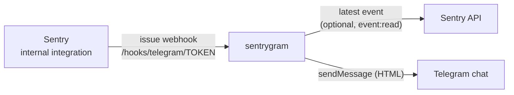

<div align="center">
  <h1>sentrygram 🚨</h1>
  <p><strong>Sentry issue alerts in a Telegram chat, with enough detail to know what broke before you open Sentry.</strong></p>
  <a href="https://github.com/rahacloud/sentrygram/actions/workflows/ci.yml"></a>
  <a href="https://github.com/rahacloud/sentrygram/actions/workflows/docker.yml"></a>
  
  <a href="LICENSE"></a>
  
  <a href="https://pkg.go.dev/github.com/rahacloud/sentrygram"></a>
  
  <br>
  
  
  <br>
  
</div>

**sentrygram** is a small HTTP service that receives the webhooks of a Sentry [internal integration](https://docs.sentry.io/organization/integrations/integration-platform/internal-integration/) and posts one Telegram message per **new issue** and per **issue that comes back** (a regression or a reopen). Every other event (each new error, assignments, resolves, Seer) is answered and dropped, so a bad deploy that throws ten thousand errors is one message per issue, not ten thousand.

It is one static Go binary with no dependencies outside the standard library, shipped as a distroless image: `ghcr.io/rahacloud/sentrygram`.

> *sentrygram* = **Sentry** + Tele**gram**. That is all it does.

## Table of contents

- [Features](#features)
- [How it works](#how-it-works)
- [What a message looks like](#what-a-message-looks-like)
- [Quick start](#quick-start)
- [Setting it up](#setting-it-up)
- [Configuration](#configuration)
- [Behaviour worth knowing](#behaviour-worth-knowing)
- [Self-hosted Sentry](#self-hosted-sentry)
- [Development](#development)
- [License](#license)

## Features

- 🎯 **One message per issue, not per error.** Only `created` and `unresolved` issue webhooks are posted; a flood of events is one alert.
- 🔍 **Context without a click.** With an API token it reads the issue's latest event and adds the environment, release, the in-app line of code that raised, the request, server and runtime.
- 🔐 **Locked down.** A secret path token, optional `Sentry-Hook-Signature` (HMAC-SHA256) checks, and the bot token never reaches a log line.
- 🧹 **Noise filter.** Drop issues by culprit prefix, such as a Django management shell.
- 🛟 **Degrades gracefully.** If Sentry's API is slow or down, the message still goes out, without the extra details.
- 🪶 **Tiny.** Standard library only, one static binary, a distroless non-root image, a `GET` health check on any path.

## How it works



## What a message looks like

```
🚨 ERROR · orders · production
ValueError: order 42 has no total
📍 app/orders/views.py:58 in retrieve
return Response(total(order))
🌐 GET https://api.example.com/api/v1/orders/42/
🏷 release 1.4.2 · python · 🔥 unhandled · high priority · server web-1 · CPython 3.14.0
📊 3 events · 2 users · first seen 2026-11-10 13:42 UTC
ORDERS-7 →
```

| Line | Where it comes from |
| --- | --- |
| 🚨 level, project, environment | the issue (🔁 and "back again" when an issue returns); the environment from its latest event |
| exception | the issue's grouping metadata (`type: value`), else its title |
| 📍 where, and the line of code | the latest event's innermost **in-app** frame of the exception that was raised, else its innermost frame; without the event, the issue's file and function, else its culprit |
| 🌐 request | the latest event's request method and URL, **without the query string or fragment**, which can carry tokens; else its transaction |
| 🏷 facts | release, platform, handled or unhandled, priority, server, runtime, browser and OS, whichever are known |
| 📊 counts | events, users and first seen, from the issue |
| link | the issue in Sentry |

Without an API token sentrygram still posts the issue's own details: everything above except the environment, release, line of code, request, server and runtime.

## Quick start

```sh
docker run -d --name sentrygram -p 8080:8080 \
  -e TELEGRAM_BOT_TOKEN=123456:ABC... \
  -e TELEGRAM_CHAT_ID=-1001234567890 \
  -e RELAY_PATH_TOKEN="$(openssl rand -base64 24 | tr '+/' '-_')" \
  -e SENTRY_URL=https://sentry.example.com \
  -e SENTRY_API_TOKEN=... \
  ghcr.io/rahacloud/sentrygram:main
```

`GET` on any path answers 200, for health checks. In production pin an immutable tag (`sha-<commit>`) rather than `main`.

## Setting it up

### 1. The Telegram bot

1. Create a bot with [@BotFather](https://t.me/BotFather) (`/newbot`) and keep its token.
2. Add the bot to the group or channel the alerts go to. In a channel it must be an administrator that may post.
3. Find the chat id: send a message in the chat and read `https://api.telegram.org/bot<token>/getUpdates`, or call `getChat` with the id you expect. Basic groups have ids like `-123456789`; supergroups and channels like `-1001234567890`.

### 2. The Sentry integration

1. In Sentry: **Settings › Developer Settings › Custom Integrations › Create New Integration › Internal Integration**.
2. **Webhook URL**: `https://<where sentrygram is reachable>/hooks/telegram/<RELAY_PATH_TOKEN>`. Any path works; sentrygram only checks its last segment.
3. **Permissions**: **Issue & Event** → **Read**. This is the `event:read` scope the API token needs.
4. **Webhooks**: tick **issue**. Leave **error** off; sentrygram would drop those anyway.
5. Save, then under **Tokens** create a token and pass it as `SENTRY_API_TOKEN`. Optionally pass the integration's **Client Secret** as `SENTRY_CLIENT_SECRET` so that every webhook's signature is checked.

### 3. Test it

A test issue has to be **new**: Sentry groups events with the same message into the existing issue, and only a new issue sends `created`. Give the test event its own fingerprint, for example with the Python SDK:

```python
import uuid, sentry_sdk
sentry_sdk.init(dsn="https://<key>@sentry.example.com/<project>")
with sentry_sdk.new_scope() as scope:
    scope.fingerprint = [f"sentrygram-test-{uuid.uuid4()}"]
    sentry_sdk.capture_message("sentrygram test", level="error")
sentry_sdk.flush()
```

sentrygram logs one JSON line per decision (`posted`, `dropped noise`, `refused an unauthorized request`, `posting without the event's details`, `telegram failed`), so `docker logs sentrygram` tells you what happened to each webhook.

## Configuration

Everything is an environment variable.

| Variable | Required | Meaning |
| --- | --- | --- |
| `TELEGRAM_BOT_TOKEN` | yes | the bot's token |
| `TELEGRAM_CHAT_ID` | yes | the chat to post to; the bot must be a member |
| `RELAY_PATH_TOKEN` | when reachable from the internet | the last path segment every webhook must carry; any other request gets a 404 |
| `SENTRY_CLIENT_SECRET` | no | the integration's client secret; checks `Sentry-Hook-Signature` (HMAC-SHA256 of the body) |
| `SENTRY_API_TOKEN` | no | the integration's token (`event:read`); adds the latest event's details |
| `SENTRY_URL` | no | Sentry's address, for the API and for links when a payload carries none; default `https://sentry.io` |
| `SENTRY_ORG` | no | the organization slug; by default it is read from the issue's link (`/organizations/<slug>/`) |
| `NOISE_CULPRITS` | no | comma-separated culprit prefixes whose issues are dropped, e.g. `django.core.management.commands.shell` |
| `ADDR` | no | listen address; default `:8080` |

## Behaviour worth knowing

- **What is posted:** webhooks with `Sentry-Hook-Resource: issue` and action `created` or `unresolved`. Everything else gets a 200 and no message.
- **Failures:** if Telegram refuses the message or cannot be reached, sentrygram answers 502, so Sentry records the delivery as failed. If reading the event from Sentry fails or takes more than 5 seconds, the message goes out without the event's details rather than not at all.
- **Secrets:** the bot token never reaches a log line; an error that would carry it has it replaced by `<token>`. Request URLs lose their query strings before they are posted.
- **Formatting:** messages use Telegram's HTML mode and everything that comes from Sentry is escaped. Long titles, culprits and lines of code are clipped.

## Self-hosted Sentry

- **Private addresses are refused.** Since 25.9, self-hosted Sentry does not send webhooks to private or reserved addresses (`SENTRY_DISALLOWED_IPS`), and its taskworker logs `send_and_save_webhook_request.restricted_ip`. So sentrygram cannot be reached as `http://sentrygram:8080` on Sentry's own compose network. Publish it behind your reverse proxy under a public name, and keep `RELAY_PATH_TOKEN` (or `SENTRY_CLIENT_SECRET`) set.
- **The `internal` project sends no integration webhooks.** Sentry skips its own project (id 1); test with another one.
- **Running it next to Sentry:** add it to Sentry's `docker-compose.override.yml`, published on an internal address your proxy reaches:

  ```yaml
  services:
    sentrygram:
      image: ghcr.io/rahacloud/sentrygram:sha-<commit>
      restart: unless-stopped
      ports:
        - "10.0.0.5:9001:8080/tcp"
      environment:
        - TELEGRAM_BOT_TOKEN=...
        - TELEGRAM_CHAT_ID=...
        - RELAY_PATH_TOKEN=...
        - SENTRY_URL=https://sentry.example.com
        - SENTRY_API_TOKEN=...
  ```

  Then route the webhook path to it, for example with Traefik's file provider:

  ```yaml
  http:
    routers:
      sentrygram:
        rule: "Host(`sentry.example.com`) && PathPrefix(`/hooks/telegram/`)"
        entrypoints: [websecure]
        service: sentrygram
        tls:
          certResolver: letsencrypt
    services:
      sentrygram:
        loadBalancer:
          servers:
            - url: "http://10.0.0.5:9001"
  ```

## Development

You need Go 1.27 and [just](https://github.com/casey/just).

```sh
just test     # go test -race with coverage
just lint     # golangci-lint
just build    # ./sentrygram
just image    # docker build
```

The code is three packages. `internal/relay` decides what is posted and writes the message, with no I/O. `internal/sentry` reads an issue's latest event from Sentry's API. `internal/telegram` sends to the Bot API. `cmd/sentrygram` wires them together from the environment. The tests use synthetic payloads in `internal/sentry/testdata/`; never commit a real event, which carries URLs, file paths and user data.

CI lints and tests every push and pull request. Every push to `main` and every `v*` tag publishes an image tagged with the branch or version and with `sha-<commit>`.

## License

[GPL-3.0](LICENSE).
